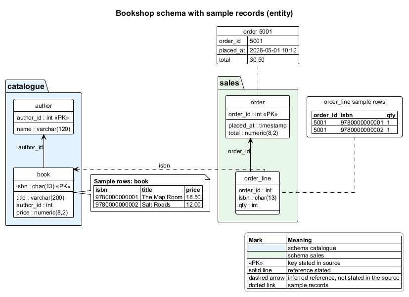

# plantsmith

A Claude Code skill that turns written sources into PlantUML diagrams under one fixed
house style, renders them on your machine, and looks at the result before handing it over.



## What it does

1. Picks the PlantUML diagram type from the shape of the content (architecture map, pipeline
   DAG, sequence with lanes, entity schema, causal chain, dated timeline).
2. Separates what the sources state from what they do not, and draws gaps as `not stated`.
3. Authors from a house preamble plus a skeleton: orthogonal edges, shapes with fixed meanings,
   one colour per meaning, a transparent legend, labels of 40 characters or fewer, detail inside
   element bodies or in notes, stores inside the stage that writes them, ER parents above children.
4. Lints the source (`scripts/lint.py`), renders SVG + PNG (`scripts/render.py`), checks the PNG
   bytes, page shape, merged arrowheads and labels against borders or lines (`scripts/labels.py`),
   then has the agent open the PNG (zooming with `scripts/crop.py`), fix
   collisions, and spend at most one more round on structure (the layout moves) or a split.
5. Draws records tables beside nodes three ways: a Creole table in a note, a table inside an
   element body, or a `json` card.

6. C4 architecture diagrams (System Context, Container) on PlantUML's bundled C4 library, with
   the C4 rules checked by the linter: typed and described elements, technology on containers,
   one-way intent labels with protocols, one level per diagram, a legend.

**Exhibits for html-plan, and a standalone page.** `scripts/exhibit.py <name>.svg` wraps a
rendered diagram as an html-plan `doc-mock` block: a self-contained SVG with a `data-ref` on every
element and line for `<doc-pin>` comments, hover highlighting (an element and its lines; the rest
dims), tooltips, and pan, zoom and a sticky highlight from a small inline script. `scripts/publish.py
<name>.svg` writes the same diagram as one self-contained HTML page with a light/dark theme and a
PNG export button, for notes that are not plans. Neither fetches anything.

**No noodle lines.** Every diagram uses straight lines with right-angle elbows; curved or tangled
lines fail the look and the linter (`no-ortho`, `curved-lines` are errors).

**Cloud icons.** On AWS work, a service the sources name (Redshift, S3, Glue, Athena, EKS, MWAA,
QuickSight, ...) is drawn with its official AWS Architecture Icon from PlantUML's bundled
`awslib20` library, inside group frames (AWS Cloud, Region, VPC, Availability Zone, subnet), or as
a sprite on a C4 container. Azure and GCP have their own bundled libraries.

See [`plantsmith/examples/`](plantsmith/examples/README.md) for nineteen worked diagrams and the
render passes behind each.

## Why local only

Diagram sources often describe internal systems. Online renderers receive the whole source.
`render.py` runs only the PlantUML on your machine. It refuses URL, absolute and `..` references
(`!include`, `%load_json`, ``), and always forces PlantUML's own security profile:
`SANDBOX`, or `ALLOWLIST` confined to the diagram's folder when the source includes a sibling file.
Hosted rendering is never used. It prints which PlantUML binary rendered.

## Install

Copy the `plantsmith/` folder into your skills folder (the commands create it if needed):

```bash
mkdir -p ~/.claude/skills/plantsmith && cp -r plantsmith/. ~/.claude/skills/plantsmith/
```

```powershell
New-Item -ItemType Directory -Force "$HOME\.claude\skills\plantsmith" | Out-Null
Copy-Item -Recurse -Force plantsmith\* "$HOME\.claude\skills\plantsmith\"
```

Then reload skills in Claude Code (or restart it). Ask for "an architecture diagram of ..."
or "a PlantUML sequence for ...".

## Requirements

- PlantUML 1.2024 or newer, with Java. Either a `plantuml` command on `PATH`, or set
  `PLANTSMITH_PLANTUML` to a command or to the path of `plantuml.jar`.
- Graphviz (`dot`), which PlantUML uses to lay out non-sequence diagrams. Set `GRAPHVIZ_DOT`
  if PlantUML cannot find it.
- Python 3.10+ (standard library only).

## Tests

```bash
python tests/test_lint.py
python tests/test_render.py   # real renders print SKIP when PlantUML is not found
python tests/test_crop.py
python tests/test_exhibit.py
python tests/test_publish.py
```

## Credits

Ideas ported with thanks, see [`plantsmith/NOTICE.md`](plantsmith/NOTICE.md):
Agents365-ai/365-skills (render, validate, look loop), microsoft/amplifier-bundle-dot-graph
(title and legend rule, shape vocabulary, separate reviewer), Dynokostya/just-works
(`<style>` over skinparam, declare participants first, no inline colours).

## License

MIT, see [`LICENSE`](LICENSE).
