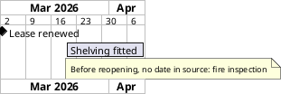

# PlantUML features (proven on PlantUML 1.2026.8)

Every snippet below rendered locally through `scripts/render.py`. Paste them below the
preamble's end marker. Official docs are linked per section.

## Records tables (three forms)

All three render. Pick by where the rows belong:

| Form | Use when | Example |
|---|---|---|
| (a) Creole table in a `note` | sample rows that explain an element, kept beside it | `examples/entity-schema` (book) |
| (b) Creole table inside an `object` (or `class`) body | the rows are a thing of their own you link to | `examples/entity-schema` (order_line sample rows) |
| (c) `json` block | one record with nested fields, shown as a card | `examples/entity-schema` (order 5001) |

```plantuml
' (a) note beside the element
note right of book
  **Sample rows: book**
  |= isbn |= title |= price |
  | 9780000000001 | The Map Room | 18.50 |
end note

' (b) table inside an element body; `object` has no class circle, `class` shows a "C"
object "order_line sample rows" as line_rows {
  |= order_id |= isbn |= qty |
  | 5001 | 9780000000001 | 1 |
}
line_rows .. line

' (c) json block inside @startuml: nested values become nested rows
json "order 5001" as order_json {
  "order_id": 5001,
  "lines": [{"isbn": "9780000000001", "qty": 1}],
  "total": 30.50
}
order_json .. order_t
```

`|=` starts a header cell. Docs: <https://plantuml.com/creole> (tables),
<https://plantuml.com/class-diagram> (a table aligns class members),
<https://plantuml.com/json> (JSON data inside a UML diagram).

## Entities grouped by schema

```plantuml
package "catalogue" <<group1>> {
  entity "book" as book {
    isbn : char(13) <<PK>>
    --
    title : varchar(200)
  }
}
package "sales" <<group2>> {
  entity "order_line" as line {
    order_id : int
    {field} isbn : char(13)
  }
}
line .up.> book
```

Key marks are text stereotypes after the type: `<<PK>>`, `<<FK>>`, `<<own key>>` print as
`«PK»`, `«FK»`, `«own key»` (`hide stereotype` does not hide field marks). Use one only where
the source states that key. A `*` before a field is NOT a key: in IE notation it marks a
mandatory (NOT NULL) column, drawn as a small filled circle; use it only where the source states
NOT NULL. The preamble's `hide circle` removes the "E" class spot. Without a `--` separator, a
type with parentheses parses as a method; `{field}` forces a field. Keep a field (name, type,
mark) at or under 48 characters so it stays on one line (lint WARN `long-field`). Plain `--`,
`..>` or `..` edges unless the source states cardinality; parents above children
(§ Layout moves, B). Docs: <https://plantuml.com/ie-diagram>.

## Containers, shapes and colour

```plantuml
package "Extract 01:00" <<group1>> {
  file "Till CSV export" as csv
  cloud "Web orders API" as api
  rectangle "Load raw files" as load
}
database "Staging DB" as staging
hexagon "Row counts match?" as counts
rectangle "Alert shop manager" as alert <<failure>>
```

Fill colour comes only from the stereotype classes in the preamble's `<style>`
(`.group1 { BackgroundColor #E3F2FD }`); `hide stereotype` keeps the names off the picture.
A failure point (STYLE rule 10) is the element where it happens, filled `<<failure>>`: a step
(`rectangle`), a store (`database "..." as d <<failure>>`), a feed (`cloud ... <<failure>>`), or an
outcome box on a check's error branch like `alert` above. Its reason goes in the element body
(§ Layout moves, C), never in a coloured note.
Docs: <https://plantuml.com/deployment-diagram>, <https://plantuml.com/style-evolution>.

## Edge captions, notes and "not stated"

```plantuml
counts --> reporting : match
search ..> catalogue : not stated: refresh
note right of counts
  Compares till rows with web rows
  per business day
end note
```

Captions sit near the edge midpoint under `linetype ortho`; keep them to a few words and put
the rest in a note. Mark thin source with dashed edges plus ONE legend row
(`| dashed line | inferred / not stated in the source |`); thirteen identical `inferred` captions
only stack on each other. Write the word on an edge only when that edge needs its own reason, as
`search ..> catalogue` above. Lint counts `..>`, `<..`, `.right.>` and `[dashed]` as dashed, but
not a plain `..` link (records cards use it), so for undirected inferred ER links the legend row
is on you. Docs: <https://plantuml.com/commons>, <https://plantuml.com/skinparam>.

## Creole inside identifiers

Labels, fields and notes are Creole text: `**bold**`, `//italic//`, `__underline__`, `~~wave~~`,
`--strike--`, `""mono""`. An identifier with a double underscore loses it: `extract__lazada__sales`
prints `extract`, underlined `lazada`, `sales`. Escape the first character of the pair with `~`:

```plantuml
rectangle "DAG extract~__lazada~__sales" as dag
note right of dag
  nonff~__{mkp}~__data_loader, 6 DAGs
end note
```

`~__` and `~_~_` both print `__`. Lint warns `creole-in-label` for an unescaped `__` or `**` in a
label, caption or entity field; notes are not checked (bold there is usually meant), so escape
identifiers in notes by hand. A body line that starts with `=` (`= warehouse_external.x`) renders
as a large bold heading: reword it ("backs warehouse_external.x") or escape it as `~=`.
Docs: <https://plantuml.com/creole>.

## Sequence lanes

```plantuml
autonumber "<b>[00]"
actor "Customer" as customer
box "Shop"
  participant "Counter staff" as staff
  database "Orders DB" as db
end box
staff -> customer : take 20% deposit
note right of customer
  not stated: deposit refund
end note
group same day
  staff -> db : save order and deposit
end
== about 10 days later ==
```

Declare every participant first, in display order. Replies (`-->`) are dashed by convention,
so source gaps are notes here. Docs: <https://plantuml.com/sequence-diagram>.

## Dated timeline (Gantt)



Only dated steps get bars or milestones. Docs: <https://plantuml.com/gantt-diagram>.

## Legend with colour swatches

```plantuml
legend right
  |= Mark |= Meaning |
  | cylinder | data store |
  |<#E3F2FD>| schema catalogue |
  | dashed arrow | inferred reference |
endlegend
```

The preamble sets `legendBackgroundColor transparent` and `legendBorderColor $LEGEND_FRAME`
(Gantt: `legend { BackgroundColor transparent; LineColor $LEGEND_FRAME }` in `<style>`). The
frame colour is the named knob `!$LEGEND_FRAME = "#999999"` at the top of the preamble; set it
to `"transparent"` there to drop the frame for every diagram.

## Layout moves

Structural fixes for the second fix round (SKILL.md step 5). Each one changed a real render's
page shape; reorder hints and direction arrows did not.

### A. A store lives inside the stage package that writes it

A repo container spanning stages 2-4, with a separate bucket package between them in the flow
(repo -> bucket -> repo), cannot stack top to bottom: Graphviz puts the stages side by side (2.70:1).
Moving each store into the stage that writes it stacked the same pipeline at 1.06:1.

Before:

```plantuml
package "repo etl" {
  package "2. Transform :00" <<group2>> {
    rectangle "Flatten JSON" as t
  }
  package "3. Load :25" <<group3>> {
    rectangle "Merge staging" as l
  }
}
package "S3 structured" {
  database "staging/" as st
}
t --> st
st --> l
```

After:

```plantuml
package "repo etl" {
  package "2. Transform :00" <<group2>> {
    rectangle "Flatten JSON" as t
    database "S3 structured staging/" as st
  }
  package "3. Load :25" <<group3>> {
    rectangle "Merge staging" as l
  }
}
t --> st
st --> l
```

### B. Entity schema: parents above children, pins, rank spacing

FK edges drawn child -> parent pointing down put the referencing tables in the top row (2.49:1).
Declare parents first, draw the FK edge upward (`.up.>`) or as an undirected `..` written
parent-first (Graphviz ranks the left end above), line up siblings with `-[hidden]-` pins, and
open the rows with `skinparam ranksep` / `nodesep`. The same schema reached 1.92:1.

Before:

```plantuml
entity "dim_comment" as c {
  product_perm_key <<FK>>
}
entity "dim_product" as p {
  perm_key <<own key>>
}
entity "dim_video" as v {
  creator_perm_key <<FK>>
}
entity "dim_creator" as cr {
  perm_key <<own key>>
}
c ..> p
v ..> cr
```

After:

```plantuml
skinparam ranksep 90
skinparam nodesep 30
entity "dim_product" as p {
  perm_key <<own key>>
}
entity "dim_creator" as cr {
  perm_key <<own key>>
}
entity "dim_comment" as c {
  product_perm_key <<FK>>
}
entity "dim_video" as v {
  creator_perm_key <<FK>>
}
p .. c
cr .. v
p -[hidden]right- cr
```

### C. Detail inside the body for elements in nested packages

`note left of` / `note right of` on an element two packages deep lands outside both packages,
often far away with a long connector. Put the detail in the body instead: a separator, then
italic lines. Notes stay for free-standing elements and records tables.

Before:

```plantuml
package "repo etl" {
  package "3. Load :25" <<group3>> {
    rectangle "update_flow merge" as l
  }
}
note right of l
  DAG nonff~__{mkp}~__data_loader, 6 DAGs
end note
```

After:

```plantuml
package "repo etl" {
  package "3. Load :25" <<group3>> {
    rectangle l [
      update_flow merge
      ....
      //DAG nonff~__{mkp}~__data_loader//
      //6 DAGs, image 497//
    ]
  }
}
```

In an `entity` body the separator is `..` (or `--`) and the italic line is a field:
`..` then `//keys in the ACTIVE update branch only//`. `database`, `cloud` and `rectangle` take
the `[ ... ]` body with `....`. Body lines and entity fields share one limit, 48 printed characters
(lint `MAX_BODY`); labels and captions stay at 40.

A self-reference (`dim_category .. dim_category`, a parent key in its own table) draws as a small
corner bracket that is easy to miss. When it matters, add a body line that says so
(`//parent_category_perm_key -> dim_category//`) instead of relying on the loop.

### D. C4 under ortho: room, one direction, short labels

The C4 preamble keeps `linetype ortho` (no noodle lines) and opens `nodesep 120` / `ranksep 110`,
because C4's two-line labels (`label` + `[tech]`) sit at a fixed point on the edge. In
`examples/c4-container` the first ortho render put four labels on lines and nodes. What fixed it:
short intent labels, every edge pointing down (`Rel_D`), externals on the rank above or beside
what they feed, the manager to the side (`Rel_L`), and `skinparam nodesep 160` for the
horizontal label. One label still straddles the boundary border (recorded). Side hints across a
boundary (`Lay_R`) made it worse:

```plantuml
System_Ext(till, "Till system", "Exports a daily CSV")
Person(manager, "Shop manager", "Reads the daily report")
System_Boundary(shop, "Bookshop online system") {
  Container(report, "Report job", "Python, cron", "Builds the daily figures")
}
Rel_D(till, report, "Delivers the daily CSV export to", "file", $tags="inferred")
Rel_U(report, manager, "E-mails the daily sales PDF to", "SMTP")
```

### E. Sibling groups side by side, row for row (AWS zones)

Two Availability Zones drift out of line (one zone's subnets start lower) unless corresponding
elements are pinned across the zones and every edge is explicit `-down->`. Proven in
`examples/aws-vpc` (1:1.85, rows aligned):

```plantuml
!include <awslib20/Compute/EC2Instance>
!include <awslib20/Database/RDS>
AvailabilityZoneGroup(az1, "Availability Zone 1") {
  EC2Instance(rp1, "Reverse Proxy", "nginx")
  RDS(db1, "Primary", "PostgreSQL")
}
AvailabilityZoneGroup(az2, "Availability Zone 2") {
  EC2Instance(rp2, "Reverse Proxy", "nginx")
  RDS(db2, "Secondary", "PostgreSQL")
}
rp1 -[hidden]right- rp2
db1 -[hidden]right- db2
rp1 -down-> db1 : stores pages (SQL)
rp2 -down-> db2 : stores pages (SQL)
```

### F. Spread fan-in endpoints

`render.py` prints `merged endpoints: N` on the size line and a `WARN merged-endpoints` line per
cluster: two or more arrowhead tips within 3 px on the SVG. Probe, 3 edges into one node
(PlantUML 1.2026.8, endpoints read from the SVG):

| Technique | Endpoints into the target |
|---|---|
| `linetype ortho` (house default) | separate, about 24 px apart on one side |
| `linetype polyline` | separate, about 12 px apart |
| default splines | separate |
| direction hints mixing sides (`-right->`, `-down->`, `-left->`) under ortho | separate, on three sides |
| `-[norank]->` under ortho | separate, but the page went flat (2.26:1) |
| member links `A --> T::f1` (object/map) | separate, one per row of the map |
| `@startdot` with `headport` (ortho or polyline) | separate; ports honoured as sides |
| C4 `Rel_D` x3 into one container | separate, about 18 px apart |
| awslib20, 2 edges into one icon | separate, about 60 px apart |

Small fan-ins separate on their own. A real merge showed up in the first c6 run: a solid CTE edge
and a dashed FK edge into `dim_category`, which also had a self-loop, stacked at one point under
ortho. When the WARN fires: reduce the fan-in (merge parallel edges into one labelled edge from a
group, or route through a junction element), move one edge to another side with a direction hint,
or drop a self-loop for a body line. Never switch to `polyline`: it trades a merge for diagonals.

### G. Labels clear of borders

`render.py` prints `label-on-node: N, label-on-edge: N` on the size line and a WARN per label that
overlaps, or comes closer than 2 px to, a node, a frame border, a frame title or another line
(STYLE rule 15). Observed under ortho: a label sits beside the middle of its line, and neither nodes
nor frames make room for it, so a short line puts it against the node at either end, and a line that
crosses a frame border puts it on the border. Probe on `examples/aws-steps` (5 findings, 1:1.18):

| Fix | Result |
|---|---|
| `skinparam ranksep 90` (longer vertical runs) | the 3 labels against the node above or below cleared (5 to 2) |
| `skinparam nodesep 160` (wider) | no change on the 2 frame-border labels; page wider |
| reverse the declaration (`order_fn <-up- api`) | no change: the label stays on the same side of its line |
| shorter second line (`invokes\n(Lambda)` for `(Lambda proxy)`) | cleared: the label sat left of its line, across the frame's left border |
| external enters from below, not the side (`manager -up-> slips`) | the label moves onto the outside run: touching at `ranksep 90`, clear at 100 |
| customer enters from the top (`customer -down-> api`) | worse (3) and 1:2.12 |
| `ranksep 120` | clear, but 1:2.07 (aspect WARN); 100 gives 1:1.94 |

Phase 1.7, the other examples (each result checked by eye at 1:1):

| Fix | Result |
|---|---|
| a longer arrow on one line (`a ---> b`: one more rank for that line only) | cleared "stores pages" (aws-vpc, both lines `--->` with `ranksep 60`), "checkout" (architecture-map), "uploads daily CSV" (gcp); the page grows less than a global `ranksep`. Phase 1.8: it also took azure "uploads daily CSV" off the bend of its own down-then-right line (label-on-own-line 6.7 px to 0), where a shorter or a split label stayed on the bend |
| split the label at the word that sits on the border (`publishes\nchanges (CDC)`, `reads secrets\n(not stated)`) | cleared the labels across stage-frame borders: azure 3 (with `nodesep 100`), gcp 2 (with `ranksep 110`) |
| shorter intent (`Writes sales to`, `E-mails the PDF to`) plus `Rel_R` to the side external and `nodesep 200` | C4: cleared all 4 |
| `skinparam ranksep 90` after the ArchiMate preamble | cleared the 2 labels touching the layer frame tops (110 broke the aspect) |
| a junction just outside the frame (`circle " " as j`) | gcp "CSV files": cleared (junction inside Google Cloud, outside Ingest). aws-vpc: the engine put it outside the zone and routed round both zones (worse). architecture-map: the label landed on the circle |
| `-right->` / `-left->` on one line of a dense graph | reflowed other labels onto lines (architecture-map "shelf counts", dag-run-states: 3-4 new crossings) |
| reverse the declaration (`b <-up- a`), or declare the other element first | no change (aws-vpc, gcp), or new crossings (dag-run-states) |

Before (the three edges behind the full example's 5 findings):

```plantuml
!include <awslib20/General/Users>
!include <awslib20/NetworkingContentDelivery/APIGateway>
!include <awslib20/Compute/Lambda>
!include <awslib20/Storage/SimpleStorageService>
AWSCloudGroup(cloud, "AWS Cloud") {
  APIGateway(api, "Web shop API", "Amazon API Gateway")
  Lambda(order_fn, "Order handler", "AWS Lambda")
  SimpleStorageService(slips, "Packing slips", "Amazon S3")
}
Users(manager, "Shop manager", "browser")
api -down-> order_fn : invokes\n(Lambda proxy)
order_fn -down-> slips : writes slip\n(S3 PUT)
manager -left-> slips : reads slips\n(HTTPS)
```

After (0 findings, 1:1.94 in the full example):

```plantuml
!include <awslib20/General/Users>
!include <awslib20/NetworkingContentDelivery/APIGateway>
!include <awslib20/Compute/Lambda>
!include <awslib20/Storage/SimpleStorageService>
skinparam ranksep 100
AWSCloudGroup(cloud, "AWS Cloud") {
  APIGateway(api, "Web shop API", "Amazon API Gateway")
  Lambda(order_fn, "Order handler", "AWS Lambda")
  SimpleStorageService(slips, "Packing slips", "Amazon S3")
}
Users(manager, "Shop manager", "browser")
api -down-> order_fn : invokes\n(Lambda)
order_fn -down-> slips : writes slip\n(S3 PUT)
manager -up-> slips : reads slips\n(HTTPS)
```

Order of moves: a shorter or split label first, then longer runs (`--->` on the one line, then
`ranksep` / `nodesep`), then an external entering on a long outside run, then a junction just outside
the frame, then splitting the diagram. A label that no move clears goes in the pass record with the
engine limit and the gap in px.

## C4 (System Context and Container)

PlantUML bundles C4-PlantUML 2.13.0 (`!include <C4/C4_Container>`; `<C4/C4_Context>` for a
Context diagram). It renders under `render.py`'s SANDBOX with no extra rule. Start from
`preambles/house-c4.puml` + `templates/skeleton-c4.puml`. Rendered on 1.2026.8:

| Macro | Use |
|---|---|
| `Person(a, "Name", "What they do")` | a person or role |
| `System(a, "Name", "Description")`, `System_Ext(...)` | the system in scope (Context) or another system |
| `System_Boundary(a, "Name") { ... }`, `Boundary(a, "Name", "type") { ... }` | the system in scope on a Container diagram; nested boundaries render |
| `Container(a, "Name", "Technology", "Responsibility")`, `ContainerDb`, `ContainerQueue` | an app, job, store or queue of the system |
| `Rel(from, to, "Intent", "Protocol")`, `Rel_D/U/L/R` | one-way relationship; the suffix steers placement |
| `Lay_D(a, b)`, `Lay_R(a, b)` | placement pin without a line |
| `AddElementTag`, `AddRelTag(..., $lineStyle=DashedLine())`, `UpdateElementStyle` | the house palette, each with `$legendText` |
| `SetPropertyHeader("Field", "Value")` + `AddProperty("k", "v")` before an element | a Field/Value records table inside that element (4 rows at most; more go in a note) |
| `SHOW_LEGEND()` | the key: only the types and tags used. Never `LAYOUT_WITH_LEGEND()` |
| `BiRel` | renders, but C4 bans it (lint ERROR `c4-birel`) |

For a cloud or platform map, the AWS style (`preambles/house-aws.puml`) is the default and
C4 the alternative (STYLE rule 14). Lint rules (`scripts/lint_c4.py`, active when `!include <C4/`
is present): `c4-element-incomplete`,
`c4-rel-unlabelled`, `c4-birel`, `c4-rel-no-tech`, `c4-weak-label`, `c4-title-format`,
`c4-mixed-level` (keyed off the title type), `c4-no-legend`, `c4-tag-no-legendtext`,
`c4-dashed-unmarked`. Legend glyphs render as empty boxes with the house font (accepted gap).

An AWS service inside a C4 diagram keeps its official icon as a sprite: include `AWSCommon` and
the service file, then pass the sprite name (the macro name) as `$sprite`:

```plantuml
!include <awslib20/AWSCommon>
!include <awslib20/Analytics/Redshift>
ContainerDb(dw, "Sales DW", "Amazon Redshift", "Facts and dimensions", $sprite="Redshift")
```

Docs: <https://c4model.com/diagrams/notation>, <https://github.com/plantuml-stdlib/C4-PlantUML>.

## Icon libraries (cloud and others)

`plantuml -stdlib` on 1.2026.8 lists the bundled libraries below. For AWS, start from
`preambles/house-aws.puml` (service include paths proven by `tests/fixtures/aws_smoke.puml`).
Every macro takes `(alias, "label", "technology")`; a 2-argument call fails and `""` prints `[]`
(lint ERROR `icon-empty-tech`); every `*Group` frame needs its label (`icon-group-unlabelled`).
Frames (STYLE rule 14): `AWSCloudGroup(alias, "AWS Cloud") { }` around the stated AWS services,
always for a platform on AWS; `RegionGroup` / `VPCGroup` / AZ / subnet only where the source states
them. Plain stage frame: `GenericGroup(alias, "Stage") { }` (`<awslib20/Groups/Generic>`, in the
preamble); it takes exactly 2 arguments (a third fails). For the AWS group look with a colour and an
icon per stage, define the look once and use the entity macro both come from:

```plantuml
!include <awslib20/Storage/SimpleStorageService>
AWSGroupColoring(StageExtract, #F2F8EC, #3F8624, dashed)
AWSGroupEntity(g_ext, "Extract", #3F8624, SimpleStorageService, StageExtract) {
  SimpleStorageService(s3, "S3 journal", "Amazon S3")
}
```

`AWSGroupColoring(name, #fill, #border, dashed|dotted|plain)`; `AWSGroupEntity(alias, "label",
#labelColour, SpriteMacro, name)`: the sprite is an included icon's macro name (`""` fails). Lint
treats both as library styling (no `inline-colour`) and warns `icon-no-cloud-frame` when awslib
service icons have no `AWSCloudGroup`. Worked case: `bakeoff c2 r4` style, `examples/aws-vpc`.
Neutral icons when the source names no service: `Genericdatabase` (`General/GenericDatabase`;
note the lower-case d: `GenericDatabase(...)` fails), `Containers` (`Containers/Containers`) for
pods, `Client`, `Internet`, `Users` (`General/...`). Worked case: the c2 platform map in AWS style.

Graded against the 420 templates of jgraph/drawio-diagrams (FULL / CLOSE / PARTIAL / NONE):

| draw.io family | PlantUML | Grade | What is lost |
|---|---|---|---|
| cloud/aws (aws4) | `awslib20` + `house-aws` | CLOSE (icons, groups FULL) | the landscape page; badges now optional (`$step`) |
| cloud/aws_legacy | redraw in `awslib20` | CLOSE | the legacy look |
| cloud/aws_3d | none | NONE | everything (isometric) |
| cloud/azure | `azure` 2.2.0 + `house-azure` | CLOSE content, PARTIAL look | white-on-solid zone blocks |
| cloud/ibm | nested `rectangle` frames + `house.puml` | CLOSE structure, NONE icons | IBM icons (no stdlib) |
| gcp | `gcp` 6.0.0 + `house-gcp` (zone stereotypes, LogicalFrame) | CLOSE | card chrome around the icon |
| network: subnets | `@startnwdiag` + `house-nwdiag` | CLOSE | device art |
| network: devices | deployment + `tupadr3` / `osa` | PARTIAL | Cisco icon set |
| software/class, uml/class, package | class / package | FULL | nothing |
| software/component | component | FULL | nothing |
| software/data_flow | component + `entity` + `skeleton-dfd` | CLOSE; row edges PARTIAL | member lines can miss their row under ortho |
| software/database, entity_relationship (IE) | `entity` (examples/entity-schema) | CLOSE; row anchoring PARTIAL | side ports on rows; Chen notation not probed |
| software/eip | component + `queue` | PARTIAL | EIP glyphs |
| software/use_case | usecase | FULL | nothing |
| software misc (ldap, BDD cards) | component; Creole table | CLOSE / PARTIAL | card grid layout |
| uml/sequence | sequence + `house.puml` | FULL | nothing |
| uml/state_machine | state + `skeleton-state` | FULL | the colours |
| uml/activity, flowcharts/flowchart, workflow | activity + `skeleton-swimlane` | FULL / CLOSE | some ANSI glyphs, phase columns |
| flowcharts/cross_functional, swimlanes | activity with `\|lane\|` | CLOSE | lanes are columns only |
| flowcharts/epc | activity | PARTIAL | EPC glyphs (hexagon already means "check") |
| business/bpmn | activity with lanes (nearest) | NONE (PARTIAL via activity) | BPMN notation |
| business/archimate | `archimate` 3.2.2 + `house-archimate` | FULL | nothing (layer order by `_Up` relations) |
| business/ishikawa | `@startwbs` + `skeleton-cause-tree` | PARTIAL | the fishbone spine (diagonals are banned) |
| engineering/fault_tree | `skeleton-cause-tree` with "AND:" / "OR:" gates | PARTIAL | gate glyphs |
| business/pert, timeline; tables/gantt | Gantt (dated); causal chain (undated) | CLOSE (Gantt), PARTIAL | chevrons, curved PERT edges |
| charts/org_chart, coc, wbs | `@startwbs` + `skeleton-wbs` | CLOSE | photos |
| maps/mind_map | `@startmindmap` + `skeleton-mindmap` | FULL (but lines curve: sketches only) | nothing |
| maps/site_map, concept_map | wbs; component | CLOSE; PARTIAL | free radial layout |
| other/decision_tree | activity `if`/`else` | CLOSE | condition / action shape split |
| engineering rest (electrical, P&ID, rack) | none | NONE | everything |
| venn, infographic, plans, world, education, layout, business grids | none; `@startsalt` for simple forms; Creole tables for grids | NONE (PARTIAL) | everything visual |

Never map a timeline to `@startchronology`: it fails on 1.2026.8 (exit 200, twice).

## html-plan exhibits

html-plan pages prove each claim with one exhibit; its `doc-mock` block is "real HTML in a frame,
scaled to fit". `scripts/exhibit.py <name>.svg [--w 480] [--frame none] [--out f.html]` turns a
rendered SVG into that block: the XML prolog and PlantUML's processing instruction go, the fixed
width/height go (the `viewBox` stays), every element, group and link PlantUML drew gets a
`data-ref` slug from its own text (`till-csv-export`, `link-row-counts-match-to-alert-shop-manager`),
and the width is capped at 480 with `thumbnail` added when the diagram is wider (html-plan's
"smallest region" rule: split the diagram per claim rather than shrink it). An `<image>` or any
remote URL is refused, so the page never fetches anything. Proven on
`examples/pipeline-dag/pipeline-dag.exhibit.html` (24 refs).

```html
<doc-mock frame="none" w="480" thumbnail><template>
<svg style="width:100%;height:auto;display:block" ... viewBox="0 0 578 1077">...</svg>
</template>
  <doc-pin ref="alert-shop-manager" title="Failure path">A mismatch alerts the manager.</doc-pin>
</doc-mock>
```

Pins go inside `doc-mock`, after `</template>`. Company diagrams stay local: never pack the page
with `--artifact` (that publishes it).

What the html-plan runtime does with the exhibit (probed in headless Chrome against html-plan
1.0.0's own `htmlplan.js` / `htmlplan.css`, 2026-10-07):

| Question | Fact |
|---|---|
| Does an inline `<script>` in the template run? | Yes, once: `doc-mock` clones `template.content` into an open shadow root and the script ran (`ran-1`). It does NOT run again in the ⤢ full-size view (still 1 run). In the shadow tree `document.getElementById` cannot see the SVG, so the script finds its SVG through the open shadow roots. |
| Do `:hover` rules in a template `<style>` apply? | Yes: the style is attached inside the shadow root (rule present; a base rule's computed fill applied). |
| What does `thumbnail` do? | Nothing at runtime: only `pack.mjs` reads it, to drop the "w ≥ 800 renders small on a phone" warning. The ⤢ button (`fig-zoom`) appears when the mock is scaled below 0.9 and opens a sheet with a full-width clone (styles cloned, script not re-run). |
| Clicks | A click on any `[data-ref]` opens an html-plan comment for that ref; the runtime also sets each ref's `.title` property (no visible tooltip on SVG). |

So `exhibit.py` ships both layers by default (`--no-interactive` for the plain SVG):
- **CSS layer** (works everywhere, including the ⤢ clone): one `<style>` scoped to the SVG's id.
  Hover an element or group and it stays at full opacity with every line that starts or ends at it
  (one rule per element, `g[data-ref="X"]:hover ~ g[data-from="X"]`, no `:has()`, because
  PlantUML writes clusters, elements, then links as siblings); everything else dims to 35 %. A
  `<title>` tooltip on every group: its own words, a link's two ends, and `name.puml:line` when
  `--puml` is given. The SVG keeps a white background so a dark plan page does not show through.
- **JS layer** (about 100 lines, inline, no network): drag to pan, Ctrl/⌘ + wheel or pinch to zoom
  (a plain wheel still scrolls the plan), double-click to reset, click for a sticky highlight of
  an element, its lines and their other ends (the html-plan comment still opens; a drag does not
  open one), and a toolbar: +, −, Reset, Legend, ⛶ Full screen (a clone of the SVG in a viewport
  overlay on `document.body`, wheel-zoom without a modifier, Esc or a click outside closes; added 2026-10-08
  because html-plan's own ⤢ sheet stays at column width).
- Icon diagrams (awslib, C4, Azure, GCP) embed their icons as `<image href="data:...">`: allowed.
  Any other `<image>` source and any remote URL are refused.

## Standalone page

`scripts/publish.py <name>.svg [--title T] [--out page.html] [--puml name.puml]` writes one
self-contained page for a vault system note: the same tagged SVG with both layers (plain wheel
zooms here), a light/dark page theme that follows the system with a Theme toggle, Legend, zoom
and Reset buttons, and a PNG button (the SVG drawn on a canvas at 2x, white background). Nothing
is fetched or vendored: no external script, style or font; the only URLs are the SVG namespace
declarations. Example: `examples/pipeline-dag/pipeline-dag.page.html`.

## Cloud platform map: acceptance checklist

Tick every row in the report (✓ / ✗ with the element). Provider-neutral; the notes below say what
each row means per provider.

1. An outer frame for the provider the sources name (AWS: `AWSCloudGroup` with the AWS logo;
   Azure / Google Cloud: a `rectangle` styled as the provider's frame, titled with the provider's
   name). Everything that runs on that provider is inside it.
2. Every stated service of that provider drawn with that provider's official icon; nothing on the
   provider drawn as a plain box. Never another provider's icons.
3. Stated regions, VPCs/VNets, subscriptions/projects, zones and subnets drawn with their dedicated
   frames; unstated ones absent, not guessed.
4. Stage frames styled like the provider's groups (a colour per stage, an icon where natural),
   never a bare grey generic frame.
5. Externals (vendors, users, systems on other platforms) outside the provider frame; systems whose
   hosting the sources do not state in a frame that says so.
6. Elbow lines only, 0 merged endpoints, no line through a node, no label on another line.
7. No label or badge on any node or frame border (`render.py` label-on-node = 0): if ortho puts
   one there, apply Layout move G (a split or shorter label, longer runs, an external on a long
   outside run, a junction just outside the frame) or move the node, until none remains or the pass
   record names the engine limit.
8. Every edge labelled `intent (protocol)`; every node with its technology.
9. Legend: one row per frame colour, per icon class used, per dashed/inferred mark.
10. Aspect within 1:2 to 2:1; lint 0 errors; title "<Type> diagram for <scope>".

Provider notes:
- **AWS** (`house-aws.puml`, awslib20): `AWSCloudGroup`, `RegionGroup`, `VPCGroup`,
  `AvailabilityZoneGroup`, `Public/PrivateSubnetGroup`; stage frames with `AWSGroupColoring` +
  `AWSGroupEntity` (§ Icon libraries). Worked case: the c2 platform map, round 4 (1:1.25).
- **Azure** (`house-azure.puml`, azure 2.2.0): no group macros; frames are `rectangle ... <<AzureCloud>>`
  and `<<AzureStage>>` from the preamble's `<style>`. Data Factory is `<azure/Databases/AzureDataFactory>`.
- **Google Cloud** (`house-gcp.puml`, gcp 6.0.0): no group macros; `<<GcpCloud>>` / `<<GcpStage>>`
  frames; every service macro takes exactly 3 arguments.

What took the c2 round-4 map to zero label defects, in order: frame titles placed away from
incoming lines (`HorizontalAlignment left|right` per frame class), two-line labels where two lines
leave a node close together (`loads\n(SQL)`), shorter intent words (`sums (Trino)`), and a hidden pin
that put the node with the long label on the far side (`rs2lh -[hidden]right- recon`).

## Numbered steps (optional)

Every line-routing preamble defines `$step(n)` and the knob `!$STEP_BADGE` (the badge colour,
#1565C0). `$step(3)` prints a blue badge with a white 3 inside any label, edge label or legend
table cell (proven in icon labels, edge labels and legend rows). Put the numbered step table in
the legend (`| $step(1) | what happens |`) and keep the intent label and protocol on every line:
`order_fn -down-> queue : $step(3) publishes\n(SQS)` (STYLE rule 16, `examples/aws-steps`).

## Data flow and column lineage

`templates/skeleton-dfd.puml`: `allowmixing`; processes `rectangle`, stores `database`, externals
`actor`, tables `entity`; column lines `src::col --> dst::col`. Under ortho these lines can enter a
table through its top and run over the row text (probed: in `examples/column-lineage` five column
lines crossed the rows of two tables). Check every one in step 5; when one misses its row, replace
the column lines with a lineage table in a note beside the target (`| target | source | rule |`),
which is what the example ships. A type with parentheses needs `{field}` in an entity body.

## GCP and Azure conventions (from the draw.io templates)

- Title option: `title Architecture: <Domain> > <Pattern>` (54 of 55 GCP templates).
- Label = role first, product second: `Cloud_Dataflow(flow, "Log processing", "Dataflow")`.
- Zone pastels as stereotypes in both preambles (meanings INFERRED from template labels; the
  templates mix them): `<<ZoneProcessing>>` #E1F5FE, `<<ZoneStorage>>` #FFF8E1, `<<ZoneAnalytics>>`
  #F1F8E9, `<<ZoneServing>>` #F3E5F5, `<<ZoneOnPrem>>` #EFEBE9, `<<ZoneExternal>>` #FFEBEE.
- Batch / Streaming groups: `rectangle "Batch" as b <<LogicalFrame>> { }` (dashed blue border, a
  logical frame; STYLE rule 21: dashed frames are logical, dashed LINES mean not stated).
- One edge style per diagram (GCP: blue 2px). Flow direction stays top to bottom (house rule 1)
  although 50 of 55 GCP templates flow left to right: that is the reviewer's call, not changed here.

## Trees, swimlanes, states, subnets, ArchiMate

- Cause tree (`skeleton-cause-tree.puml`, `@startwbs`): categories `<<data>>`, `<<process>>`,
  `<<tooling>>`, `<<people>>`, the problem `<<failure>>`, evidence as an italic second line; a gate
  is `*** AND: <what> <<gate>>` (a `<<AND>>` stereotype would not print). `examples/incident-cause-tree`.
- Ownership tree (`skeleton-wbs.puml`): the authority matrix (decides / consulted / told) is the
  legend table. `examples/ownership-tree`.
- Swimlane (`skeleton-swimlane.puml`): `|Lane|` columns; set the lane again inside every branch
  that changes lane (a step after `else` stays in the last lane otherwise); decisions render as
  hexagons, joins as diamonds. `examples/runbook-swimlane`.
- State (`skeleton-state.puml`): `hide empty description` drops the empty compartment; the start
  dot renders as a ring with `!theme plain`. `examples/dag-run-states`.
- Subnet map (`house-nwdiag.puml`): networks as bars, hosts hang from them; the lines are straight
  drops drawn by nwdiag (not routed, linetype does not apply) and the address labels sit on them.
  `examples/subnet-map`.
- ArchiMate (`house-archimate.puml`): the library resets the line type, so the preamble sets ortho
  AFTER the include; `Rel_*_Up` keeps business above application above technology. Grouping frames
  are dashed (logical). `examples/archimate-layers`.
- Mind map (`skeleton-mindmap.puml`): its engine draws curved lines, so it fails "No noodle lines":
  use it for a brainstorm sketch, and the wbs skeleton for anything delivered. `examples/report-ideas`.

## Local-only rendering

`render.py` forces `PLANTUML_SECURITY_PROFILE=SANDBOX` (no file or network access; the bundled
stdlib such as `<C4/C4_Context>` still works). When the source reads a sibling file it forces
`ALLOWLIST` with `PLANTUML_ALLOWLIST_PATH` set to the diagram's folder instead. SANDBOX blocks even
sibling includes, and ALLOWLIST lets a `../` path escape its folder, so `render.py` also refuses URL,
absolute and `..` targets before PlantUML runs. Inherited profile settings are overridden.
Docs: <https://plantuml.com/security>.
